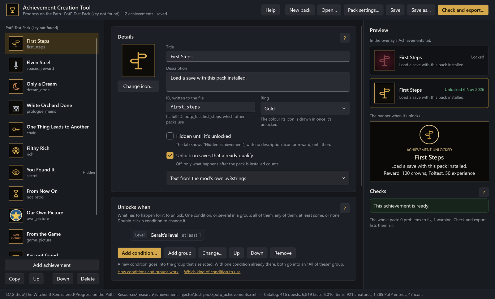
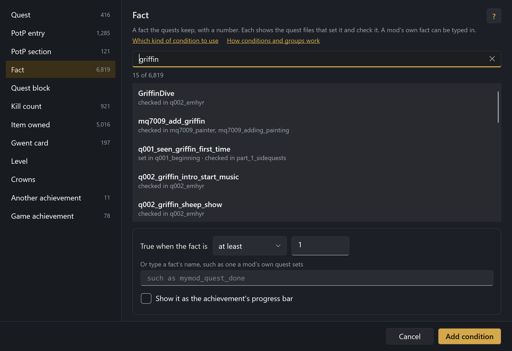
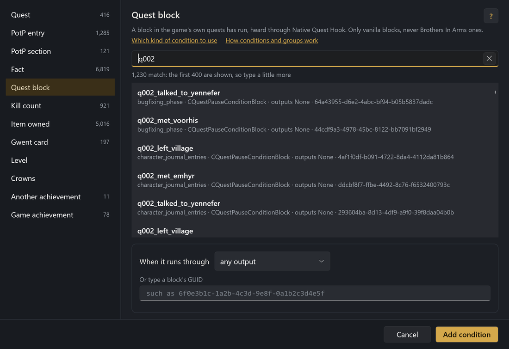
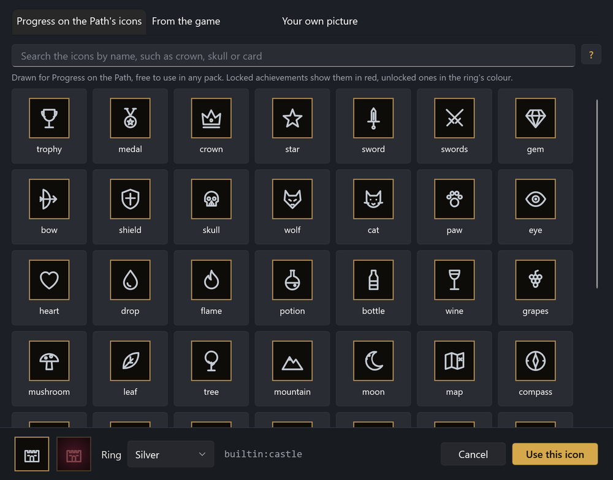
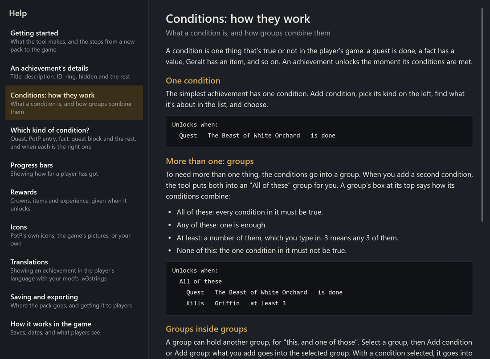
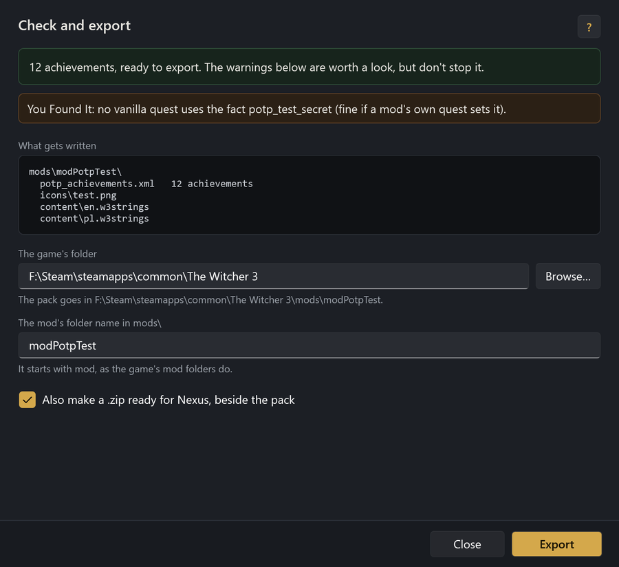

# Progress on the Path: Achievement Creation Tool

Make your own achievements for **The Witcher 3: Wild Hunt**, shown in
[Progress on the Path](https://github.com/Faen668/Progress-On-The-Path)'s overlay beside the game's own.

Pick what unlocks each one from lists of the game's quests, facts, quest blocks, items, Gwent cards and creatures, and
everything Progress on the Path tracks. Choose an icon, a progress bar and a reward of crowns, items or experience, and
export it as a mod. In the game, your achievements get a section of their own in PotP's Achievements tab, unlock with
PotP's banner at the top of the screen, and give their rewards.



## Download

Get the latest from the [Releases page](https://github.com/Faen668/Progress-On-The-Path-Achievement-Creation-Tool/releases):
unzip it anywhere and run `PotPAchievementTool.exe`. It needs Windows 10 or 11 (64-bit), and nothing else to install.
Keep the `catalog` folder beside the exe: it's what the tool picks from.

## What it does

- **Every condition picked from a list.** Quests by their title, Progress on the Path's entries and sections, facts
  (each showing the quest files that set and check it), quest blocks with their outputs, kill counts, items, Gwent
  cards, Geralt's level, crowns, the game's own achievements, and your pack's other achievements. A mod's own facts and
  items can be typed in.
- **Conditions in groups:** all of these, any of these, at least a number of them, or none of this, inside each other
  as deep as you need.
- **Progress bars** for anything with a number: "3 of 5 griffins on this save".
- **Rewards:** crowns, items and experience, given once when it unlocks.
- **Icons:** 47 drawn for Progress on the Path, any picture from the game's files, or your own PNG.
- **Translations:** each title and description can come from your mod's own `.w3strings`, in the player's language.
- **A live preview** of each achievement as the overlay shows it, locked and unlocked, and the banner it unlocks with.
- **Checks** as you work, so nothing's exported that the game would skip.
- **Export** straight into the game's `mods` folder, and a zip ready for Nexus.
- **A guide built in:** the Help button, F1 in any window, or the **?** beside each part opens the article for it.

| Finding a fact by name, with the quests that use it | Quest blocks, by quest file, with their outputs |
|---|---|
|  |  |

| Progress on the Path's own icons | The built-in guide |
|---|---|
|  |  |

## What players need

- The Witcher 3: Wild Hunt, next-gen (4.04 or later)
- [Progress on the Path](https://github.com/Faen668/Progress-On-The-Path) with its overlay
- [Native Quest Hook](https://github.com/Faen668/NativeQuestHook), which Progress on the Path uses already, for quest
  block conditions

A pack is a mod folder of its own (`mods\modYourPack`), so it installs like any other mod and works beside other packs.

## Using it

1. **New pack**, then **Pack settings**: an ID for the pack (such as `velen_adventures`) and a title, which becomes the
   section's heading in the Achievements tab.
2. **Add achievement** for each one: a title, a description of what it asks, and an icon.
3. **Add condition** for what unlocks it. Add a second and both go into an "All of these" group; change the group to
   "Any of these", "At least" or "None of this" as you need.
4. Optionally, a **progress bar** and a **reward**.
5. **Save** into an empty folder: it becomes your mod's folder, with your pictures in `icons\` and any `.w3strings` in
   `content\`.
6. **Check and export** lists anything to fix, then copies the pack into the game's `mods` folder.

With the game running, Progress on the Path reads a pack again within a few seconds of it being exported, so you can
see a change without restarting.



### How unlocks work in the game

- Unlocks belong to the save: a new game starts with every achievement locked, and loading an older save takes back
  what was unlocked since, rewards included.
- "Unlock on saves that already qualify" decides whether a player who's already done what it asks gets it at once.
- The Achievements tab shows the date each was unlocked, as it does for the game's own.

## The format

The tool writes `potp_achievements.xml`, version 1 of Progress on the Path's custom achievements format. It can be
written by hand too; the tool opens any pack, made by it or not.

## Building

Windows, with the [.NET 9 SDK](https://dotnet.microsoft.com/download/dotnet/9.0):

```
dotnet build src/AchievementCreationTool/AchievementCreationTool.csproj -c Release
```

The exe is `src/AchievementCreationTool/bin/Release/net9.0-windows/PotPAchievementTool.exe`, with the catalog beside
it in `catalog\`. To run, that build needs the .NET 9 Desktop Runtime.

A release is published self-contained, as one exe that needs no runtime installed:

```
dotnet publish src/AchievementCreationTool/AchievementCreationTool.csproj -c Release -r win-x64 --self-contained true -p:PublishSingleFile=true -p:IncludeNativeLibrariesForSelfExtract=true -p:EnableCompressionInSingleFile=true -p:DebugType=none -o publish/PotPAchievementTool
```

Two switches for testing:

- `--shots <folder> [pack]` saves a picture of every window, off screen.
- `--roundtrip <in> <out>` reads a pack and writes it again, to check nothing's lost on the way.

## The catalog

`catalog\` holds everything the tool picks from, so it runs on its own, without the game's files or REDkit:

| File | What's in it |
|---|---|
| `quests.json` | the game's journal quests |
| `facts.json` | the facts the quests set and check, and which quest files do |
| `quest_blocks.json` | every block in the game's quest files, with its outputs |
| `items.json` | the game's items, with their names in English; Gwent cards are the ones in category `gwint` |
| `kills.json` | the names Progress on the Path counts kills by |
| `potp.json` | Progress on the Path's sections and entries |
| `achievements.json` | the game's own achievements |
| `icons.json` | Progress on the Path's achievement icons |

They're made from REDkit's copy of the game's files by Progress on the Path's
`overlay/tools/gen_achievement_catalog.py`, with W3 Mod Workbench decoding the quest and journal files.

## Credits

By Faen90. Made for Progress on the Path, and with the help of W3 Mod Workbench and Native Quest Hook.

## Licence

The tool's code and Progress on the Path's achievement icons are MIT licensed: see [LICENSE](LICENSE).

The catalog's names, IDs and English text come from The Witcher 3 and belong to CD PROJEKT RED. They're included so
pack authors can refer to the game's own content. The Witcher is a trademark of CD PROJEKT S.A.; this tool isn't made
or endorsed by CD PROJEKT RED.
